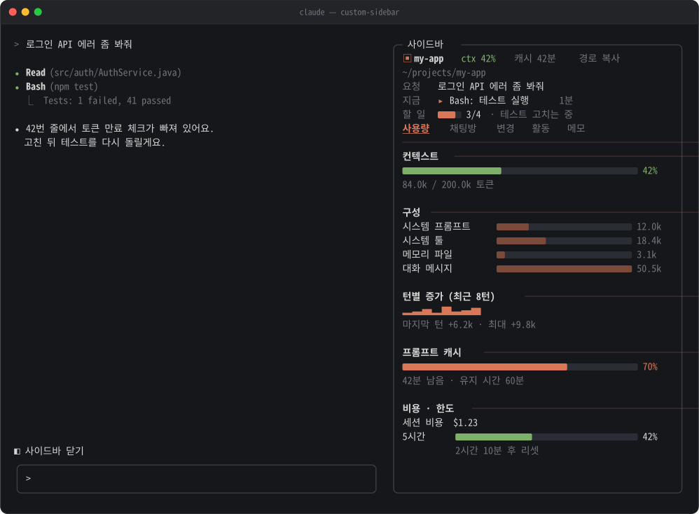
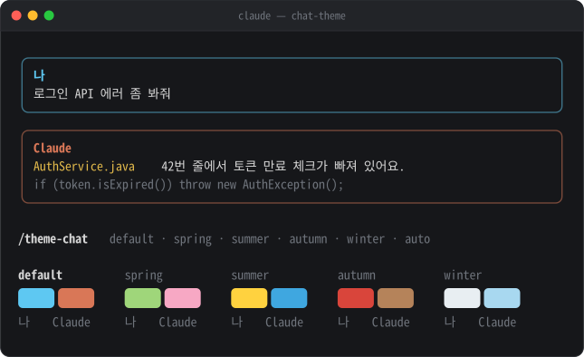
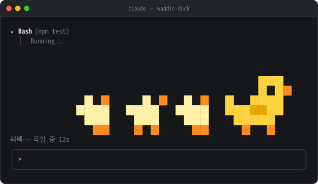

<div align="center">

# claude-code-mods

**Claude Code를 내 손에 맞게 바꾸는 mod 모음**

사이드바 · 채팅 테마 · 작업 중 오리

</div>

| mod | 하는 일 | 명령 |
|---|---|---|
| [**custom-sidebar**](#custom-sidebar) | 오른쪽 사이드바: 컨텍스트·한도·비용, 프롬프트 캐시, 채팅방, Git 변경, 활동, 메모 | `/side` `/room` |
| [**chat-theme**](#chat-theme) | 내 메시지와 Claude 답변을 색 있는 상자로 감싸 채팅처럼 보이게 | `/theme-chat` |
| [**waddle-duck**](#waddle-duck) | Claude가 일하는 동안 프롬프트 위로 픽셀 오리 가족이 걸어감 | `/duck` |

## 설치

Claude Code 터미널의 프롬프트에 붙여넣으세요. 원하는 것만 골라도 됩니다.

```
/plugin install custom-sidebar --marketplace 100bee/claude-code-mods
/plugin install chat-theme --marketplace 100bee/claude-code-mods
/plugin install waddle-duck --marketplace 100bee/claude-code-mods
```

1. 처음 한 번 `Add marketplace?`가 뜨면 `y`
2. 설치 범위는 맨 위 `user`(모든 프로젝트에서 켜짐)에서 Enter
3. `Installed … Plugin is now active.`가 나오면 끝. 재시작 없이 바로 동작합니다

<details>
<summary>셸에서 설치하기 · 데스크톱 앱에서 설치하기</summary>

셸:

```sh
claude plugin install custom-sidebar --marketplace 100bee/claude-code-mods
```

데스크톱 앱(`/plugin`이 안 되는 곳): 프롬프트 옆 **+** → **Plugins** → **Add marketplace**에 `100bee/claude-code-mods` 입력 → **Add plugin**

</details>

Claude Code v2.1.287 이상이 필요합니다.

---

## custom-sidebar



넓은 터미널(약 144칸 이상)에서는 세션을 시작하면 오른쪽에 저절로 붙습니다.

| 하고 싶은 것 | 방법 |
|---|---|
| 열기 · 닫기 | `/side` 또는 프롬프트 위 `◧ 사이드바` 버튼 |
| 탭 이동 | 사이드바 안에서 `1`~`5`, `Esc`는 프롬프트로, `Ctrl+X` `X`는 닫기 |
| 지금 채팅에 이름 붙여 저장 | `/room + 로그인 버그` 또는 채팅방 탭에서 입력 |
| 저장한 채팅으로 이동 | `/room 로그인` (앞 글자만 쳐도 됨) |

- **맨 위**: 현재 폴더, `ctx 42%`, 프롬프트 캐시 남은 시간, 지금 요청 · 하는 일 · 할 일 진행, 승인이 필요하면 `⚠`
- **사용량**: 컨텍스트 게이지(50% 주황, 70% 빨강 + `압축하기` 버튼), 항목별 구성, 턴별 증가, 세션 비용, 5시간·7일 한도
- **채팅방**: 이름 붙인 채팅 사이 이동. 다른 폴더 채팅은 새 터미널 창으로 열기
- **변경**: 브랜치, 바뀐 파일(`●`는 Claude가 고친 파일), 누르면 diff
- **활동**: 메인 · 서브에이전트 · 백그라운드 셸 타임라인, 요청별로 쓴 도구
- **메모**: 세션을 넘어 남는 체크리스트

chat-theme을 같이 쓰면 사이드바 강조색이 고른 팔레트를 따라갑니다. 자세한 설명은 [custom-sidebar/README.md](custom-sidebar/README.md)에 있습니다.

---

## chat-theme



메시지 내용(마크다운, 코드 블록, 표)은 Claude Code가 그리는 그대로 두고 바깥만 감쌉니다.

| 명령 | 하는 일 |
|---|---|
| `/theme-chat default` | 나 하늘색 / Claude 주황 (기본값) |
| `/theme-chat spring` · `summer` · `autumn` · `winter` | 사계절 팔레트 |
| `/theme-chat auto` | 날짜에 맞는 계절 팔레트 |
| `/theme-chat box` · `line` | 둥근 상자(기본값) / 위아래 줄만 |
| `/theme-chat on` · `off` | 켜기 · 끄기 |
| `/theme-chat` | 지금 설정 보기 |

`/theme`은 Claude Code에 이미 있는 명령이라 `/theme-chat`을 씁니다. 자세한 설명은 [chat-theme/README.md](chat-theme/README.md)에 있습니다.

---

## waddle-duck



프롬프트를 보낸 뒤 답이 끝날 때까지 엄마 오리와 새끼 오리들이 왼쪽에서 오른쪽으로 걸어가고, 아래에 경과 시간이 보입니다. 끝나면 사라집니다. 데스크톱 앱에서는 🐥 🐥 🐥 🦆 글자가 걸어갑니다.

| 명령 | 하는 일 |
|---|---|
| `/duck s` · `m` · `l` | 오리 크기 (4 · 8 · 12줄, 기본 `m`) |
| `/duck 0` ~ `/duck 3` | 새끼 오리 수 (기본 3마리) |
| `/duck on` · `off` | 켜기 · 끄기 |
| `/duck` | 지금 설정 보기 |

설정은 다음 세션에도 남습니다. 자세한 설명은 [waddle-duck/README.md](waddle-duck/README.md)에 있습니다.

---

## 업데이트 · 끄기 · 지우기

```sh
claude plugin marketplace update claude-code-mods   # 새 버전 목록 받기
claude plugin update custom-sidebar@claude-code-mods
claude plugin disable chat-theme@claude-code-mods   # 잠깐 끄기 (enable로 다시 켜기)
claude plugin uninstall waddle-duck@claude-code-mods
```

Claude Code 안에서는 `/plugin` → **Installed**에서도 켜고 끌 수 있습니다.

## 새 mod 추가하기

이 레포는 marketplace라서 폴더 하나와 목록 한 줄이면 새 mod가 생깁니다.

1. `<mod 이름>/` 폴더에 `.claude-plugin/plugin.json`, `hooks/hooks.json`, `hooks/register.tsx`
2. [`.claude-plugin/marketplace.json`](.claude-plugin/marketplace.json)의 `plugins`에 `{ "name": "<mod 이름>", "source": "./<mod 이름>" }` 추가
3. 검사: `claude plugin validate .` 와 `claude plugin test <mod 이름>`
4. 커밋하고 push → 누구나 `/plugin install <mod 이름> --marketplace 100bee/claude-code-mods`

기존 mod를 고쳤으면 그 mod의 `plugin.json`에서 `version`을 올려 주세요. 설치한 사람이 `claude plugin update`로 받아 갑니다.
